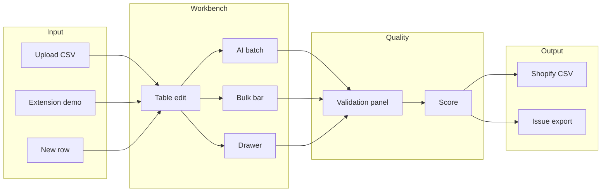
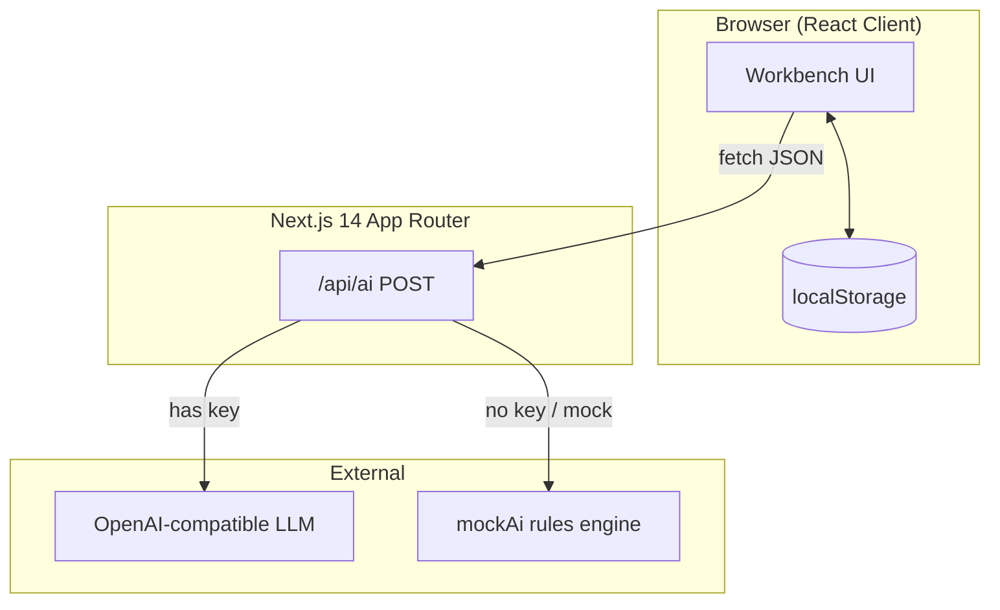

<div align="center">

# SellerFlow AI

### Cross-border commerce · Product listing Copilot

**One pipeline from supplier CSV / capture preview → AI titles → multilingual translation → bulk edits → Shopify validation → export.**

**中文文档：[README.md](./README.md)**

[](https://nextjs.org/)
[](https://react.dev/)
[]()
[]()

[Quick start](#-quick-start) · [Features](#-features) · [Workflow](#-workflow) · [Docs](#-documentation) · [Roadmap](#-roadmap)

</div>

---

## ✨ Why SellerFlow AI?

For cross-border sellers, the bottleneck is rarely sourcing — it is **turning messy supplier data into listings that publish cleanly, convert, and pass platform rules**.

SellerFlow AI compresses that into a repeatable chain:

```text
  Import CSV        AI boost         Human polish       Quality gate       Export
 ┌─────────┐      ┌─────────┐       ┌─────────┐       ┌─────────┐       ┌─────────┐
 │ Shopify │ ──▶  │ SEO title│ ──▶  │ Bulk edit│ ──▶  │ Validate │ ──▶  │ Shopify │
 │   CSV   │      │ Translate│       │  Drawer  │       │  Score   │       │   CSV   │
 └─────────┘      └─────────┘       └─────────┘       └─────────┘       └─────────┘
```

| Pain point | SellerFlow answer |
| --- | --- |
| Inconsistent CSV headers | **Smart header mapping** — Shopify & EN/ZH aliases; unknown columns kept in `extras` |
| Weak or robotic titles | **AI titles** (60–120 char SEO-oriented) + **mock mode** without an API key |
| Multiple markets | **6-language batch translate** (EN / ZH / JA / ES / DE / FR) with export columns |
| Hundreds of SKUs to retag or reprice | **Bulk edit bar**: set, find-replace, prefix/suffix, case, trim, clear translations |
| Shopify import rejections | **Shopify-oriented rules** + **0–100 completeness score**; export skips fatal errors |
| API keys in the browser | **`/api/ai` server proxy** — any OpenAI-compatible endpoint |

---

## 🚀 Quick start

### Requirements

- **Node.js** 18+
- Modern browser (Chrome / Edge / Firefox)

### Run locally

```bash
git clone https://github.com/yimaomao-max/sellerflow-ai.git
cd sellerflow-ai
npm install
npm run dev
```

Open **[http://localhost:3000](http://localhost:3000)**.

> On first visit, **3 sample products** load automatically. You can run **AI batch**, **Validate**, and **Export** end-to-end without a CSV file.

### Production build

```bash
npm run build
npm start
```

**[Vercel](https://vercel.com)** is a natural fit for Next.js. Configure AI env vars in your host — see below.

---

## 🎯 Features

### 1. Product workbench

- Searchable table with filters: all / with errors / clean only  
- Inline edit + **detail drawer**: main fields, translations, source vs AI layered fields (PRD: immutable source)  
- Data in browser **localStorage** (MVP — no backend account required)

### 2. Smart CSV import / export

**Header alias examples** (case-insensitive, EN/ZH):

| Header alias | Field |
| --- | --- |
| Title / Name / 商品标题 | `title` |
| Body HTML / Description / 描述 | `description` |
| Price / 售价 | `price` |
| Compare at price / 划线价 | `compareAtPrice` |
| SKU / 货号 | `sku` |
| Vendor / 品牌 | `vendor` |
| Handle / Slug | `handle` |

Export includes translated `title:xx` and description columns; unmapped columns round-trip via `extras`.

### 3. AI tasks (title · translate · rewrite)

| Task | Description |
| --- | --- |
| `title` | SEO title from name, description, category, tags; optional output language |
| `translate` | Batch translate title & description to selected languages |
| `rewrite` | Structured description rewrite (bullet-style benefits) |

**Resolution order**: request `mock` → Settings API key → server `OPENAI_API_KEY` → **mock AI fallback**

### 4. Bulk edit (selection-based)

Set value · find & replace · prefix/suffix · upper/lower case · trim · clear field · clear one language’s translation

### 5. Validation & completeness score

**Shopify-style checks**:

- **Error (blocks export)**: missing title, title > 255 chars, invalid price, duplicate SKU, etc.  
- **Warning**: short title, missing description, compare-at ≤ price, incomplete translations, etc.  

Per-product **0–100 score** (Error −15 / Warning −5). Header chips show **Ready to export** when clean.

### 6. Extension capture demo (`/extension-demo`)

Full **Chrome MV3 extension** is on the roadmap. Today: **capture preview UI** — pick images, confirm fields, push into workbench `localStorage` for demos and UX validation.

---

## 🔁 Workflow



**Suggested path for new users (~5 min)**

1. **Load samples** or **Import** CSV  
2. Select rows → **AI batch** (mock mode first)  
3. Open **Validate**, fix red Errors  
4. **Export** (default: rows without fatal errors only)  
5. Shopify Admin → Products → Import  

Step-by-step guide: **[User guide (EN)](docs/USER-GUIDE.en.md)** · [中文](docs/USER-GUIDE.md)

---

## ⚙️ AI & secrets

### Option A: In-app settings (local try-out)

1. **Settings** (top right)  
2. Base URL, API Key, model name (OpenAI-compatible)  
3. Turn off **Use mock mode**  

Settings live in localStorage; calls go through `/api/ai` — **keys are not sent to third-party origins from the browser bundle**.

### Option B: Environment variables (deploy)

Create `.env.local` at the repo root (never commit):

```env
OPENAI_API_KEY=sk-your-key
OPENAI_BASE_URL=https://api.openai.com/v1
OPENAI_MODEL=gpt-4o-mini
```

Any **Chat Completions–compatible** gateway works (DeepSeek, Moonshot, Azure OpenAI, etc.) — adjust `OPENAI_BASE_URL`.

---

## 🏗️ Architecture



| Layer | Stack |
| --- | --- |
| Framework | Next.js 14 App Router, React 18 (JSX) |
| CSV | [PapaParse](https://www.papaparse.com/) |
| Styling | `globals.css` design tokens + component classes |
| State | React Hooks + localStorage |
| AI | Server route handler — mock + LLM dual path |

### Project layout

```text
app/
  page.jsx                 # Main workbench
  extension-demo/page.jsx  # Extension capture UI demo
  api/ai/route.js          # AI proxy
components/                # Import/export, AI, bulk edit, drawer, validation, settings
lib/                       # product model, CSV, validate, mockAi
docs/                      # PRD, architecture, user guides (EN/ZH)
```

---

## 📚 Documentation

| Doc | Contents |
| --- | --- |
| [User guide (EN)](docs/USER-GUIDE.en.md) | Step-by-step, FAQ, sample CSV |
| [用户指南 (ZH)](docs/USER-GUIDE.md) | 中文操作手册 |
| [PRD V1](docs/PRD-V1.md) | Scope & requirements (ZH) |
| [Tech architecture](docs/TECH-ARCHITECTURE.md) | Target: extension + SaaS + DB (ZH) |
| [MVP task list](docs/MVP-TASK-LIST.md) | Milestones (ZH) |
| [Market validation playbook](docs/MARKET-VALIDATION-PLAYBOOK.md) | GTM experiments (ZH) |

Index: [docs/README.en.md](docs/README.en.md) · [docs/README.md](docs/README.md)

---

## 🗺️ Roadmap

This repo is the **web workbench MVP** (local-first, CSV loop). PRD-aligned next steps:

| Phase | Capability |
| --- | --- |
| **Now** ✅ | CSV workbench, 3 AI tasks, validation score, extension demo ingest |
| **Next** | Chrome MV3 capture (AliExpress / Alibaba / CJ), accounts & cloud sync |
| **Later** | Variants & markup rules, brand voice templates, Shopify Admin API drafts |

Long-term principles:

- **Immutable source data** — source, AI draft, and current value kept separate  
- **Human review first** — AI suggests; you publish  
- **CSV before API** — V1 does not auto-write to the store  

---

## 🤝 Contributing & feedback

[GitHub Issues](https://github.com/yimaomao-max/sellerflow-ai/issues) welcome for bugs, ideas, or sanitized CSV samples.

```bash
npm run dev
```

Please run `npm run build` before opening a PR.

---

## 📄 Disclaimer

SellerFlow AI is an independent MVP. Not affiliated with Shopify, AliExpress, or other platforms. Always human-review listings for accuracy and compliance before export.

---

<div align="center">

**Listing faster. Ship cleaner. Sell global.**

Built for cross-border sellers · [yimaomao-max/sellerflow-ai](https://github.com/yimaomao-max/sellerflow-ai)

</div>