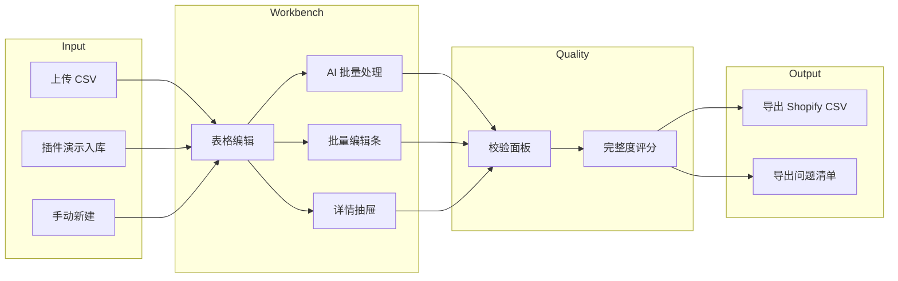
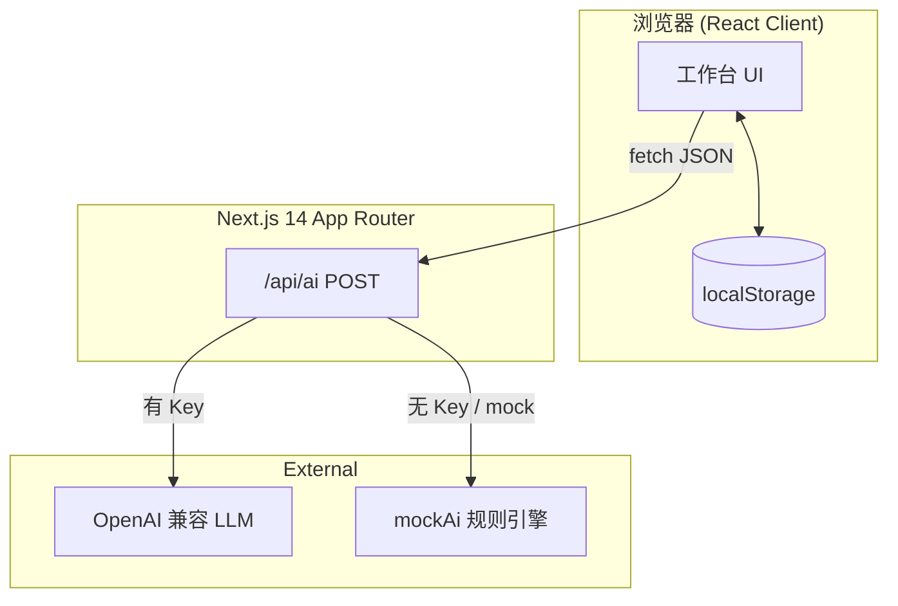

<div align="center">

# SellerFlow AI

### 跨境电商 · 商品资料 Copilot

**从供应商 CSV / 采集预览，到 AI 标题、多语言翻译、批量修整、Shopify 规范校验，一条流水线搞定 Listing。**

**English: [README.en.md](./README.en.md)**

[](https://nextjs.org/)
[](https://react.dev/)
[]()
[]()

[快速开始](#-快速开始) · [功能亮点](#-功能亮点) · [工作流](#-工作流) · [文档](#-文档) · [路线图](#-路线图)

</div>

---

## ✨ 为什么选择 SellerFlow AI？

跨境卖家最耗时的不是「找品」，而是 **把供应商粗糙的资料变成能上架、能转化、能过平台规范的 Listing**。

SellerFlow AI 把这件事压缩成一条可重复的操作链：

```text
  导入 CSV          AI 增强           人工微调          质量门禁           导出
 ┌─────────┐      ┌─────────┐       ┌─────────┐      ┌─────────┐      ┌─────────┐
 │ Shopify │ ──▶  │ 标题 SEO │ ──▶  │ 批量编辑 │ ──▶  │ 评分校验 │ ──▶  │  Shopify │
 │ 平台 CSV │      │ 多语翻译 │       │ 对照抽屉 │      │ 问题清单 │      │   CSV    │
 └─────────┘      └─────────┘       └─────────┘      └─────────┘      └─────────┘
```

| 痛点 | SellerFlow 的做法 |
| --- | --- |
| 表头五花八门 | **智能表头映射**，Shopify / 中英表头自动识别，未知列保留到 `extras` |
| 标题不像人写的 | **AI 标题**（60–120 字符 SEO 导向）+ 无 Key **模拟模式** 可先演示 |
| 要多国市场 | **6 语种批量翻译**（英 / 中 / 日 / 西 / 德 / 法），导出带语言列 |
| 几十上百 SKU 要改价、改前缀 | **批量编辑条**：设置、查找替换、前后缀、大小写、清空翻译等 |
| 导入 Shopify 被拒 | **内置 Shopify 规则校验** + **0–100 完整度评分**，仅导出无致命错误的行 |
| API Key 不想暴露在前端 | **`/api/ai` 服务端代理**，支持任意 OpenAI 兼容接口 |

---

## 🚀 快速开始

### 环境要求

- **Node.js** 18+
- 现代浏览器（Chrome / Edge / Firefox）

### 本地运行

```bash
git clone https://github.com/yimaomao-max/sellerflow-ai.git
cd sellerflow-ai
npm install
npm run dev
```

浏览器打开 **[http://localhost:3000](http://localhost:3000)**（落地页：[`/welcome`](/welcome)）。

> 首次进入会自动载入 **3 条示例商品**，可直接点「AI 批量处理」「校验」「导出」走完整闭环，无需准备 CSV。

**Chrome 采集（M1）**：加载仓库 [`extension/`](extension/README.md) → AliExpress 商品页采集 → 下载 JSON → 工作台 **「采集 JSON」** 导入。

### 生产构建

```bash
npm run build
npm start
```

部署目标推荐 **[Vercel](https://vercel.com)**（Next.js 原生支持）。AI 相关环境变量在部署平台配置即可，见下文。

---

## 🎯 功能亮点

### 1. 商品工作台

- 可搜索、可筛选（全部 / 仅有错误 / 仅干净）的商品表格
- 行内编辑 + **详情抽屉**：主字段、翻译、原始/AI 分层字段对照（对齐 PRD「原始数据不可变」）
- 数据保存在浏览器 **localStorage**（MVP 无后端账号，即开即用）

### 2. CSV 智能导入 / 导出

**识别字段示例**（大小写、中英文别名均可）：

| 表头别名 | 映射字段 |
| --- | --- |
| Title / Name / 商品标题 | `title` |
| Body HTML / Description / 描述 | `description` |
| Price / 售价 | `price` |
| Compare at price / 划线价 | `compareAtPrice` |
| SKU / 货号 | `sku` |
| Vendor / 品牌 | `vendor` |
| Handle / Slug | `handle` |

导出时自动附带已翻译语言的 `title:xx` 与描述列；未映射列从 `extras` 原样带回。

### 3. AI 能力（标题 · 翻译 · 描述重写）

| 任务 | 说明 |
| --- | --- |
| `title` | 基于名称、描述、类目、标签生成 SEO 标题，可指定输出语言 |
| `translate` | 批量翻译标题与描述到所选语言 |
| `rewrite` | 结构化商品描述重写（卖点列表风格） |

**调用优先级**：请求体 `mock` → 设置页 API Key → 服务端 `OPENAI_API_KEY` → **自动降级模拟 AI**

### 4. 批量编辑（选中即改）

支持对选中行批量：`设置为` · `查找替换` · `前/后缀` · `大小写` · `去空格` · `清空字段` · `清空某语言翻译`

### 5. 质量校验与完整度评分

按 **Shopify 上架常见约束** 检查：

- **Error（阻断导出）**：缺标题、标题超长、价格无效、SKU 重复等  
- **Warning**：标题过短、缺描述、原价低于售价、翻译不完整等  

每商品 **100 分制评分**（Error −15 / Warning −5），顶部状态条实时展示「可导出」。

### 6. 插件采集演示（`/extension-demo`）

独立 Chrome 插件（MV3）在路线图中；当前提供 **采集预览 UI 演示**：模拟从商品页勾选图片、确认字段后 **写入工作台 localStorage**，便于产品验证与路演。

---

## 🔁 工作流



**推荐操作顺序（新用户 5 分钟上手）**

1. 点击 **载入示例数据** 或 **导入 CSV**  
2. 勾选若干行 → **AI 批量处理**（先用默认模拟模式）  
3. 打开 **校验**，按提示修复红色 Error  
4. **导出**（默认仅导出无致命错误的商品）  
5. 在 Shopify 后台 → Products → Import 验证  

详细图文步骤见 **[用户指南](docs/USER-GUIDE.md)** · [User guide (EN)](docs/USER-GUIDE.en.md)

---

## ⚙️ AI 与密钥配置

### 方式 A：界面设置（适合本地试用）

1. 点击右上角 **⚙ 设置**  
2. 填写 **Base URL**、**API Key**、**模型名**（OpenAI 兼容）  
3. 取消 **使用模拟模式**  

配置保存在 localStorage，请求经 `/api/ai` 转发，**密钥不会出现在前端网络包里给其他域名**。

### 方式 B：环境变量（适合部署）

在项目根目录创建 `.env.local`（勿提交 Git）：

```env
OPENAI_API_KEY=sk-your-key
OPENAI_BASE_URL=https://api.openai.com/v1
OPENAI_MODEL=gpt-4o-mini
```

也可使用 DeepSeek、Moonshot、Azure OpenAI 等 **同一套 Chat Completions 协议** 的网关，只需改 `OPENAI_BASE_URL`。

---

## 🏗️ 技术架构



| 层级 | 技术 |
| --- | --- |
| 框架 | Next.js 14 App Router、React 18（JSX，无 TypeScript 门槛） |
| CSV | [PapaParse](https://www.papaparse.com/) |
| 样式 | 单文件 `globals.css` 设计变量 + 组件级 class |
| 状态 | React Hooks + localStorage 持久化 |
| AI | 服务端 Route Handler，Mock 与 LLM 双通路 |

### 目录结构

```text
app/
  page.jsx                 # 主工作台
  extension-demo/page.jsx  # 插件采集 UI 演示
  api/ai/route.js          # AI 代理
components/
  AiPanel.jsx              # AI 任务选择与进度
  BulkEditBar.jsx          # 批量编辑
  IoButtons.jsx            # 导入 / 导出
  ProductDrawer.jsx        # 商品详情与分层字段
  SettingsModal.jsx        # 模型配置
  ValidationPanel.jsx      # 校验报告
lib/
  product.js               # 模型、表头映射、语言
  csv.js                   # 解析与导出
  validate.js              # Shopify 校验与评分
  mockAi.js                # 模拟 AI + LLM 调用
docs/                      # PRD、架构、用户指南
```

---

## 📚 文档

| 文档 | 内容 |
| --- | --- |
| [用户指南](docs/USER-GUIDE.md) · [EN](docs/USER-GUIDE.en.md) | 逐步操作、FAQ、示例 CSV |
| [PRD V1](docs/PRD-V1.md) | 产品需求与版本边界 |
| [技术架构](docs/TECH-ARCHITECTURE.md) | 目标态：插件 + SaaS + 数据库 |
| [MVP 任务清单](docs/MVP-TASK-LIST.md) | 里程碑拆解 |
| [市场验证手册](docs/MARKET-VALIDATION-PLAYBOOK.md) | 获客与验证假设 |

---

## 🗺️ 路线图

当前仓库为 **Web 工作台 MVP**（本地优先、CSV 闭环）。与 PRD 对齐的后续能力：

| 阶段 | 能力 |
| --- | --- |
| **Now** ✅ | CSV 工作台、AI 三任务、校验评分、模拟插件入库 |
| **Next** | Chrome MV3 采集（AliExpress / Alibaba / CJ）、账号与云端同步 |
| **Later** | 变体与加价规则、品牌语气模板、Shopify Admin API 草稿写入 |

产品原则（长期不变）：

- **原始数据不可变** — 采集源、AI 稿、当前稿分层保存  
- **人工审核优先** — AI 建议，人不点不发布  
- **先 CSV 后 API** — V1 不自动写店  

---

## 🤝 贡献与反馈

欢迎通过 [GitHub Issues](https://github.com/yimaomao-max/sellerflow-ai/issues) 提交 Bug、需求或 CSV 样例（可脱敏）。

本地开发：

```bash
npm run dev
```

提交前请确保 `npm run build` 通过。

---

## 📄 声明

SellerFlow AI 为独立产品原型 / MVP，与 Shopify、AliExpress 等平台无官方关联。导出 CSV 前请务必人工审核商品信息与合规要求。

---

<div align="center">

**Listing faster. Ship cleaner. Sell global.**

Made with focus for cross-border sellers · [yimaomao-max/sellerflow-ai](https://github.com/yimaomao-max/sellerflow-ai)

</div>